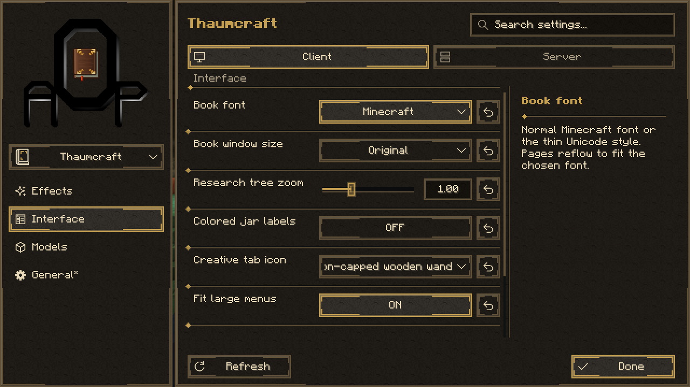

# AOP: UI


Shared configuration interface for AOP mods on **Minecraft 1.21.1 / NeoForge**.

[Русский](README.ru.md)



## Overview

AOP: UI provides a common settings screen for AOP: Thaumcraft 4, Thaumic Tinkerer and AOP:TC4 Compact. Only registered participants are displayed; the library does not require any consumer mod.

- Themed navigation with an in-place mod selector and category icons.
- Search, descriptions, validated controls, lists and default-value restoration.
- Keyboard navigation and English/Russian interface translations.
- Dependent controls that retain individual preferences when disabled by a parent.
- Separate handling of local settings, server permissions and restart-required values.

[Tinkerer theme](docs/images/thaumictinkerer.png) | [Compact theme](docs/images/compact.png) | [Dropdown control](docs/images/dropdown.png)

## Requirements and installation

| Component | Requirement |
| --- | --- |
| Minecraft | 1.21.1 |
| NeoForge | 21.1.252 ≤ version < 21.2 |
| Java | 21 |

Install the AOP: UI gameplay JAR on both client and server alongside compatible builds of the consuming mods. Each consumer retains its own dependencies. Compact remains optional on the server.

The settings screen opens from the Mods configuration button, the Thaumonomicon gear or the AOP: UI button in the pause menu. Closing the screen returns to its previous parent screen.

## Configuration behavior

| Scope | Editing and persistence |
| --- | --- |
| Client | Client and local startup settings; valid client changes save immediately |
| Server | Connected world and server startup settings; changes save with **Save** or **Esc** |
| Restart-required options | Saved values are retained separately from the effective values until restart |

Server settings are unavailable without a loaded world. Multiplayer editing requires OP level 4. The singleplayer world owner can edit without enabling cheats; other players have read-only access.

Validation failures and concurrent changes keep the editor open with an explanation. Refresh requires confirmation before discarding a server draft. Successfully saved server configuration is synchronized to connected clients. The interface does not restart the server automatically.

Existing TOML filenames, keys, defaults, validation rules and unrelated configuration entries are preserved. Dependent settings are disabled through their parent without overwriting their individual saved values.

## Building from source

The PowerShell wrapper also supports a local workspace: when the parent contains `.aop-workspace`, build outputs, caches and run profiles stay in that parent directory. Without the marker, the repository uses its normal `build/` and `runs/` directories. Gradle accepts `-PaopWorkspace=<directory>` for an explicit output location.

With JDK 21 installed, run:

```powershell
./gradlew.ps1 build
```

On Linux and macOS, use `sh ./gradlew build`. Artifacts are written to `build/libs/`. The gameplay artifact is `aopui-1.21.1-0.7.0.jar`; the sources JAR is intended for development.

Build the library before its consumers. Consumer Gradle builds accept `-PaopUiJar=/path/to/aopui-1.21.1-0.7.0.jar`. Library classes must not be bundled into consumer artifacts.

## Integration API

Register the provider after its NeoForge configuration sources and before reading startup switches:

```java
SettingsRegistry.register("my_mod", "My Mod", UiTheme.THAUMCRAFT);
```

The registration overload accepting `ModConfigSpec...` limits the interface to explicitly selected sources. `registerCategory(modId, path, translationKey)` supplies category labels without changing the TOML hierarchy.

The client entry point is `SettingsClient.screen(parent, "my_mod")`. Client classes are separated from the common registry and server handlers.

All STARTUP options must declare NeoForge's `gameRestart()` metadata. Provider registration captures their effective startup values, preventing a saved edit from partially changing runtime behavior before restart.

### Dependent settings

Both values must belong to the same configuration source:

```java
SettingsRegistry.registerDependency("my_mod", SPEC, PORTAL_TOOLTIPS, TOOLTIPS);
boolean showPortalHints = SettingsRegistry.enabled("my_mod", SPEC, PORTAL_TOOLTIPS);
```

A disabled parent locks and indents child controls while retaining their saved preferences. Dependencies may be nested; cycles and values from another configuration source are rejected. Runtime consumers must use `enabled()` or an equivalent parent check to honor the relationship outside the menu.

### Themes and loader integration

Built-in themes are `UiTheme.THAUMCRAFT`, `UiTheme.TINKERER` and `UiTheme.COMPACT`. Custom themes use `new UiTheme(namespace, textureFolder, textColor, mutedColor, accentColor)` and may reference consumer resources. Shared grayscale textures are tinted at render time; theme illustrations retain their own artwork.

Configuration discovery and NeoForge synchronization are isolated in `NeoForgeConfigs`. The adapter uses the loader's existing synchronization path and requires separate review when targeting another loader version.

## Verification and continuous integration

In **Actions → Build and release → Run workflow**, enable **release** to publish an ordinary GitHub release with tag `v<version>`. Leave **version** blank to use `mod_version` from `gradle.properties`, or enter `major.minor.patch` to override it for that run. The selected version is used in the JAR metadata, filenames and tag; the workflow does not modify the source files. Prerelease suffixes are rejected in release mode. Existing release tags are never overwritten. Pushes to `main` and manual runs with **release** disabled update the single `nightly` prerelease. Nightly JAR versions use `<mod_version>-nightly.<source_commit>`. Pull requests build artifacts without publishing. Local `act` runs never publish. Ordinary release notes list every commit since the nearest previous ordinary release on the selected history, with commit links and a comparison link. The first release includes the full history. Nightly notes omit this list.

Individual CI and **Build mod suite** use the same build recipes and `aop-suite-manifest.json` format. An individual workflow builds or reuses only its component and required dependencies, then publishes only its own component. The suite can import its JARs from that repository's Releases when source revision and contents, version, toolchain, recipe and dependency checksums match. Repository caches are independent; published JARs provide reuse across repositories. A nightly run accepts matching release or nightly artifacts; an ordinary release accepts only release artifacts, including dependencies. The `force_rebuild` input bypasses ready JARs and preserves Gradle caching. Keep `.github/scripts/suite.py` and `release.py` identical across the four repositories when updating the shared artifact contract.

`build` runs configuration rule tests and compiles verification sources. Native client and server scenarios use a separate verification source set excluded from the gameplay artifact.

GitHub Actions builds source and build-system changes. Documentation-only changes do not trigger a build. The workflow can be run locally with `act pull_request`.

Consumer workflows use `Salossov/aop-ui` by default. The optional `AOPUI_REPOSITORY` variable overrides the repository in `owner/repository` format; `AOPUI_REF` defaults to `main`.

## Author and terms

Code and artwork: [Salossov](https://github.com/Salossov). All rights reserved.
