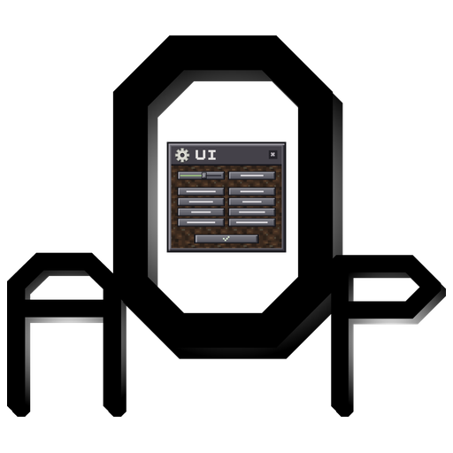
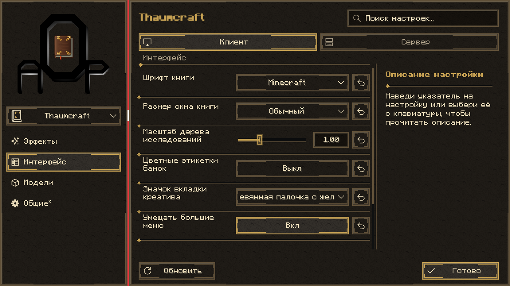

# AOP: UI



Общий интерфейс настроек модов AOP для **Minecraft 1.21.1 / NeoForge**.

[English](README.md)



## О проекте

AOP: UI предоставляет общее меню настроек для AOP: Thaumcraft 4, Thaumic Tinkerer и AOP:TC4 Compact. Отображаются только зарегистрированные участники; сама библиотека не требует установки этих модов.

- Тематическое оформление, выбор мода на месте и категории с иконками.
- Поиск, описания, проверка значений, списки и восстановление значений по умолчанию.
- Управление с клавиатуры, русский и английский языки интерфейса.
- Связанные настройки с сохранением индивидуальных значений при отключении родителя.
- Раздельная обработка локальных настроек, серверных прав и параметров перезапуска.

[Тема Tinkerer](docs/images/thaumictinkerer.png) | [Тема Compact](docs/images/compact.png) | [Выпадающий список](docs/images/dropdown.png)

## Требования и установка

| Компонент | Требование |
| --- | --- |
| Minecraft | 1.21.1 |
| NeoForge | От 21.1.252 до 21.2, не включая 21.2 |
| Java | 21 |

Игровой JAR AOP: UI устанавливается на клиент и сервер вместе с совместимыми сборками использующих его модов. Собственные зависимости каждого мода сохраняются. Установка Compact на сервер остаётся необязательной.

Меню открывается кнопкой настройки в Mods, шестерёнкой Таумономикона или кнопкой AOP: UI в меню паузы. После закрытия выполняется возврат на предыдущий экран.

## Работа с конфигурацией

| Область | Изменение и сохранение |
| --- | --- |
| Клиент | Клиентские и локальные стартовые параметры; допустимые клиентские изменения сохраняются сразу |
| Сервер | Параметры подключённого мира и запуска сервера; изменения сохраняются кнопкой **«Сохранить»** или клавишей **Esc** |
| Параметры перезапуска | Сохранённое и действующее значения учитываются отдельно до перезапуска |

Серверные настройки недоступны без загруженного мира. Для изменения в многопользовательской игре требуется OP 4. Владелец одиночного мира может редактировать настройки без включения читов; остальным игрокам доступен просмотр.

При ошибке проверки или конкурентном изменении редактор остаётся открытым с пояснением. Обновление значений требует подтверждения перед удалением серверного черновика. Успешно сохранённая серверная конфигурация синхронизируется с подключёнными клиентами. Автоматический перезапуск сервера не выполняется.

Сохраняются исходные имена TOML, ключи, значения по умолчанию, проверки и посторонние записи конфигурации. Отключение родительской настройки блокирует дочерние элементы без перезаписи их индивидуальных значений.

## Сборка из исходников

PowerShell-обёртка поддерживает локальную рабочую папку: при наличии `.aop-workspace` в родительском каталоге сборки, кэши и профили запусков остаются там. Без этого маркера используются обычные каталоги `build/` и `runs/` репозитория. Явный путь вывода задаётся через `-PaopWorkspace=<каталог>`.

При установленном JDK 21 выполняется команда:

```powershell
./gradlew.ps1 build
```

В Linux и macOS используется `sh ./gradlew build`. Артефакты создаются в `build/libs/`. Игровой артефакт - `aopui-1.21.1-0.7.0.jar`; sources JAR предназначен для разработки.

Библиотека собирается до использующих её модов. В команды Gradle потребителей передаётся `-PaopUiJar=/path/to/aopui-1.21.1-0.7.0.jar`. Классы библиотеки не должны включаться в артефакты потребителей.

## API интеграции

Поставщик регистрируется после источников конфигурации NeoForge, до чтения стартовых переключателей:

```java
SettingsRegistry.register("my_mod", "My Mod", UiTheme.THAUMCRAFT);
```

Перегрузка с `ModConfigSpec...` ограничивает интерфейс явно выбранными источниками. Метод `registerCategory(modId, path, translationKey)` задаёт подписи категорий без изменения структуры TOML.

Клиентская точка входа - `SettingsClient.screen(parent, "my_mod")`. Клиентские классы отделены от общего реестра и серверных обработчиков.

Все параметры STARTUP должны объявлять метаданные NeoForge `gameRestart()`. При регистрации поставщика фиксируются действующие стартовые значения, поэтому сохранённое изменение не приводит к частичному изменению поведения до перезапуска.

### Связанные настройки

Оба значения должны принадлежать одному источнику конфигурации:

```java
SettingsRegistry.registerDependency("my_mod", SPEC, PORTAL_TOOLTIPS, TOOLTIPS);
boolean showPortalHints = SettingsRegistry.enabled("my_mod", SPEC, PORTAL_TOOLTIPS);
```

Отключённый родитель блокирует дочерние элементы, сохраняя их значения. Дочерние параметры отображаются с отступом. Допускаются вложенные зависимости; циклы и значения из другого источника отклоняются. Для применения связи вне меню игровой код должен использовать `enabled()` или эквивалентную проверку родителя.

### Темы и взаимодействие с загрузчиком

Встроенные темы: `UiTheme.THAUMCRAFT`, `UiTheme.TINKERER` и `UiTheme.COMPACT`. Для собственной темы используется `new UiTheme(namespace, textureFolder, textColor, mutedColor, accentColor)`. Ресурсы могут принадлежать потребителю. Общие монохромные текстуры окрашиваются при отрисовке; тематические иллюстрации сохраняют собственное оформление.

Обнаружение конфигураций и синхронизация NeoForge изолированы в `NeoForgeConfigs`. Адаптер использует штатный механизм загрузчика и требует отдельной проверки при переходе на другую версию загрузчика.

## Проверки и непрерывная интеграция

Для выпуска обычного GitHub Release откройте **Actions → Build and release → Run workflow** и включите **release**. Релиз получает тег `v<версия>`. Пустое поле **version** использует `mod_version` из `gradle.properties`; значение `major.minor.patch` переопределяет версию только для этого запуска. Выбранная версия применяется к метаданным JAR, именам файлов и тегу; исходные файлы workflow не изменяет. Суффиксы предварительных версий в режиме релиза отклоняются. Существующие теги релизов не перезаписываются. При выключенном **release** ручной запуск только собирает артефакты. Локальный `act` ничего не публикует. Заметки обычного релиза содержат все коммиты после ближайшего предыдущего обычного релиза в выбранной истории, ссылки на коммиты и сравнение. Первый релиз включает всю историю. В nightly этот список не добавляется.

`build` выполняет проверки правил конфигурации и компилирует проверочные исходники. Нативные клиентские и серверные сценарии находятся в отдельном наборе исходников, исключённом из игрового артефакта.

GitHub Actions собирает изменения исходников и сборочной системы. Правки только документации сборку не запускают. Для локального запуска workflow используется `act pull_request`.

Workflow потребителей по умолчанию используют `Salossov/aop-ui`. Необязательная переменная `AOPUI_REPOSITORY` переопределяет репозиторий в формате `owner/repository`; `AOPUI_REF` по умолчанию равен `main`.

## Автор и условия использования

Код и оформление: [Salossov](https://github.com/Salossov). Все права защищены.
